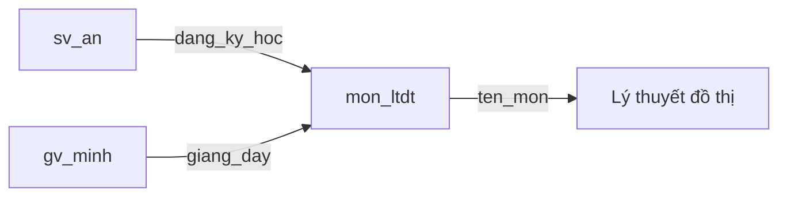

# Bảng dữ liệu mẫu đồ thị Quản lý môn học của TV1

Tài liệu này là nơi Thành viên 1 liệt kê danh sách các đỉnh và lập bảng các bộ ba dữ liệu mẫu cho chủ đề Quản lý môn học tại trường đại học. Thành viên 2 sẽ dựa vào bảng này để viết code nạp vào kho `Store` của Oxigraph trong hàm `tv2_nap_du_lieu`.

## 1. Quy ước đặt tên đỉnh và cạnh

Để Thành viên 2 và Thành viên 3 ghép code dễ dàng, thống nhất cách đặt tên như sau:

* Tên đỉnh thực thể và tên cạnh viết liền không dấu, các từ ngăn cách bằng dấu gạch dưới. Ví dụ: `sv_an`, `mon_ltdt`, `gv_minh`, `khoa_cntt`, `dang_ky_hoc`, `giang_day`.
* Giá trị văn bản hoặc con số đặt trong cặp dấu ngoặc kép để Thành viên 2 nhận biết đưa vào `Literal`. Ví dụ: `"Nguyễn Văn An"`, `"Lý thuyết đồ thị"`, `"3"`.

## 2. Danh sách các đỉnh trong đồ thị mẫu từ 10 đến 15 đỉnh

Thành viên 1 liệt kê đủ tên các đỉnh xuất hiện trong bài ở danh sách dưới đây:

1. `sv_an` : Sinh viên Nguyễn Văn An
2. `mon_ltdt` : Môn Lý thuyết đồ thị
3. `gv_minh` : Giảng viên Trần Minh
4. ... điền thêm các đỉnh tiếp theo cho đủ từ 10 đến 15 đỉnh ...

## 3. Bảng các bộ ba dữ liệu mẫu

Bảng dưới đây đã có sẵn 3 dòng ví dụ minh họa cho Sinh viên, Môn học và Giảng viên. Thành viên 1 giữ nguyên 3 dòng ví dụ hoặc điều chỉnh cho khớp kịch bản rồi điền tiếp cho đủ từ 10 đến 15 bộ dữ liệu:

| STT | Chủ ngữ là đỉnh bắt đầu | Vị ngữ là cạnh quan hệ | Tân ngữ là đỉnh kết thúc hoặc giá trị |
| :--- | :--- | :--- | :--- |
| 1 | `sv_an` | `dang_ky_hoc` | `mon_ltdt` |
| 2 | `mon_ltdt` | `ten_mon` | `"Lý thuyết đồ thị"` |
| 3 | `gv_minh` | `giang_day` | `mon_ltdt` |
| 4 | | | |
| 5 | | | |
| 6 | | | |
| 7 | | | |
| 8 | | | |
| 9 | | | |
| 10 | | | |
| 11 | | | |
| 12 | | | |
| 13 | | | |
| 14 | | | |
| 15 | | | |

## 4. Sơ đồ đồ thị có hướng minh họa

Thành viên 1 vẽ lại sơ đồ đồ thị bằng Mermaid vào khung dưới đây hoặc đính kèm file ảnh sơ đồ vào thư mục dự án:

